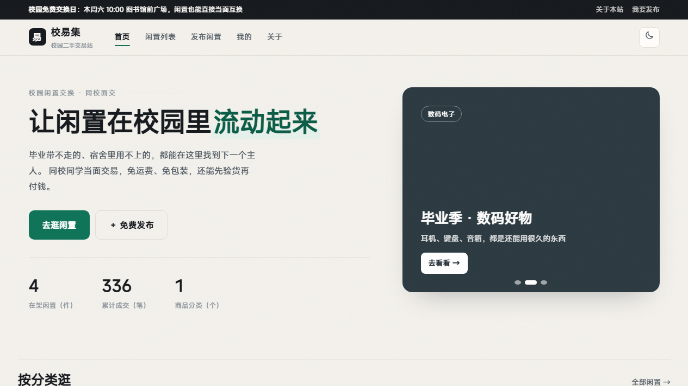
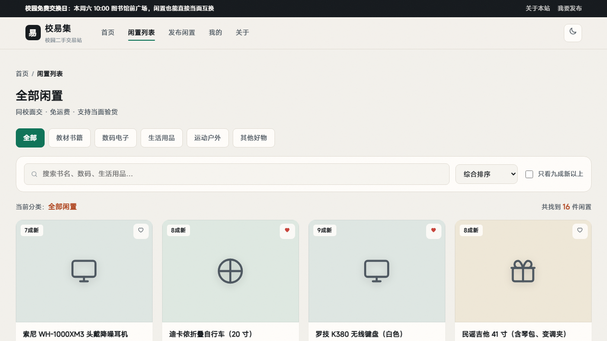
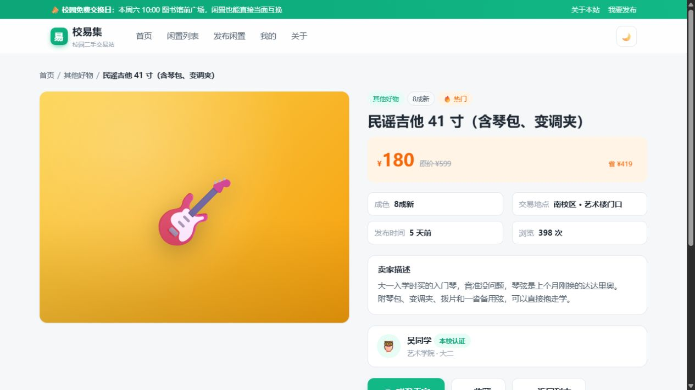
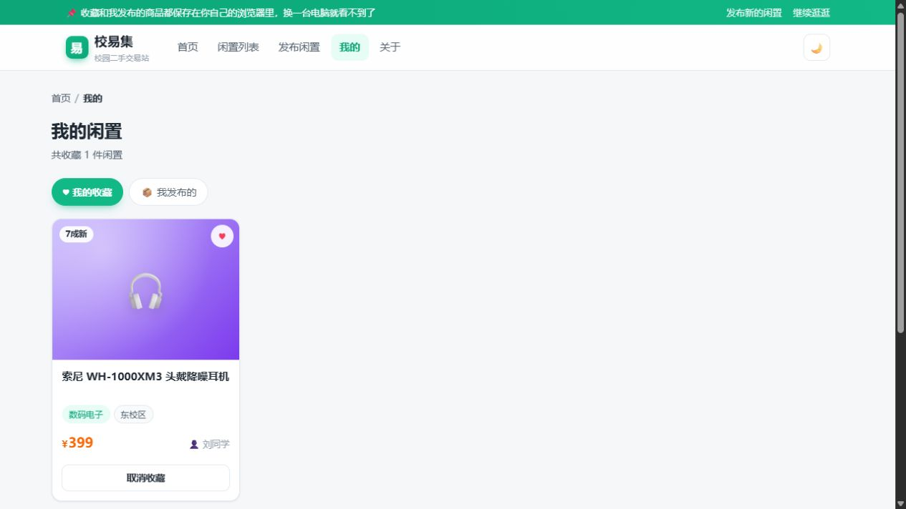

# 校易集 · 校园二手交易站

一个纯前端的校园闲置交换网站，共 6 个页面，不需要安装任何环境，双击 `index.html` 就能看。

> 课程上机作业。站内所有商品、卖家、微信号与统计数据均为虚构，不存在真实交易行为。

## 界面预览

| 首页 | 闲置列表 |
| --- | --- |
|  |  |

| 商品详情 | 我的 |
| --- | --- |
|  |  |

---

## 一、怎么打开

**在线地址（推荐）**：<https://kysr04.github.io/campus-market/>

打开就能用，收藏和发布功能都正常。

**本地打开**：直接双击 `index.html`，用 Chrome / Edge 打开即可。
如果浏览器禁用了本地存储，收藏和发布功能会失效，
这时在项目目录下打开命令行执行：

```
python -m http.server 8000
```

然后浏览器访问 `http://127.0.0.1:8000/`。

> 首页右上角的主题按钮可以切换深色和浅色主题，初次打开时会跟随系统设置。

---

## 二、目录结构

```
campus-market/
├── index.html        首页：轮播图、分类入口、热门与最新商品、数字统计
├── list.html         闲置列表：分类筛选、关键词搜索、排序
├── detail.html       商品详情：成色/地点/卖家信息、收藏、联系卖家
├── publish.html      发布闲置：表单校验、成色选择、自动算折扣
├── mine.html         我的：我收藏的 + 我发布的（可取消收藏、下架）
├── about.html        关于本站：设计目的、技术说明、考核点对照
├── css/
│   └── style.css     全站样式（含深色主题、响应式）
├── js/
│   ├── data.js       商品数据：分类、成色、14 件示例商品
│   └── app.js        全部交互逻辑
└── images/
    └── README.txt    图片目录说明（当前封面用 CSS 渐变，无需图片文件）
```

---

## 三、页面与功能

| 页面 | 主要功能 |
| --- | --- |
| 首页 index.html | 三张自动轮播图（可手动切换）、5 个分类入口、热门与最新商品、数字滚动统计 |
| 列表 list.html | 分类标签筛选、关键词搜索、四种排序、只看九成新以上、空状态提示 |
| 详情 detail.html | 动态面包屑、大图、原价对比、成色与交易地点、卖家卡片、收藏、联系卖家弹窗（可复制微信号）、同类推荐 |
| 发布 publish.html | 六个字段的前端校验、成色单选、描述字数统计、提交后写入本地存储并跳转 |
| 我的 mine.html | 标签页切换「我的收藏 / 我发布的」，可取消收藏或下架 |
| 关于 about.html | 建站目的、功能清单、技术实现说明、考核点对照、交易安全提示 |

**关于跳转**：全站通过顶部导航（6 个页面互相连通）、面包屑、分类入口卡片、
商品卡片、详情页「返回列表」、页脚链接、回到顶部按钮，形成完整的跳转链路。

---

## 四、用到的技术

- **HTML5**：语义化标签（`header` / `nav` / `main` / `section` / `footer` / `article`），
  六套页面共用同一套头部与页脚结构。
- **CSS3**：自定义属性（CSS 变量）统一管理配色，一套变量切换深浅主题；
  Flex 与 Grid 布局；卡片悬浮动效与依次淡入动画；媒体查询适配平板与手机。
- **原生 JavaScript（ES6）**：模板字符串渲染商品卡片、数组 `filter` / `sort` 实现筛选排序、
  输入防抖、`URLSearchParams` 读取网址参数、localStorage 本地保存、
  事件委托处理全站收藏按钮、自定义校验规则表。

---

## 五、考核点对照

| 考核点 | 本站对应的实现 |
| --- | --- |
| 设计目的 | 面向校园闲置交换，解决"东西卖不掉、想要找不到"的问题，内容和视觉围绕同一主题 |
| 跳转 | 导航栏、面包屑、分类入口、卡片跳详情、返回列表、页脚链接、回到顶部 |
| 交互 | 轮播、筛选、搜索、排序、收藏、表单校验、联系卖家弹窗、深浅色切换、本地存储 |
| CSS | 变量与主题、Flex/Grid、渐变封面、悬浮动效、淡入动画、响应式 |
| 整体效果 | 统一配色与圆角规范、每个分类固定配色、深色模式、空状态与失败提示 |

---

## 六、想改哪儿，看这里

- **换商品**：改 `js/data.js` 里的 `PRODUCTS` 数组，照着现有格式加一条就行。
  不写 `emoji` 会自动用分类图标；想让封面用真实照片，加上 `img: "images/xxx.jpg"`。
- **换配色**：改 `css/style.css` 开头 `:root` 里的 `--brand`（主色）和 `--accent`（价格色），全站一起变。
- **换分类**：改 `js/data.js` 的 `CATEGORIES`，并在 `css/style.css` 里加一条对应的渐变变量。
- **加页面**：复制任意一个 HTML 文件，把 `<body data-page="...">` 改成新名字，
  再在 `js/app.js` 的 `init()` 里加上对应的初始化分支。

---

## 七、已知限制

- 没有后端，商品数据写在前端文件里；收藏和我发布的内容存在浏览器 localStorage 中，
  换浏览器或清空缓存会丢失。
- 商品封面使用 CSS 渐变色块而不是真实照片，属于有意设计（避免依赖网络图片）。
- 未做注册登录、消息通知、真实支付等真实二手平台需要的功能。
